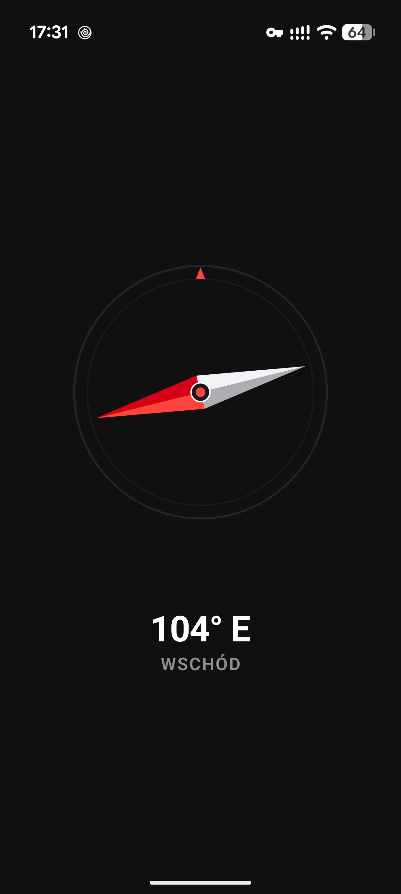
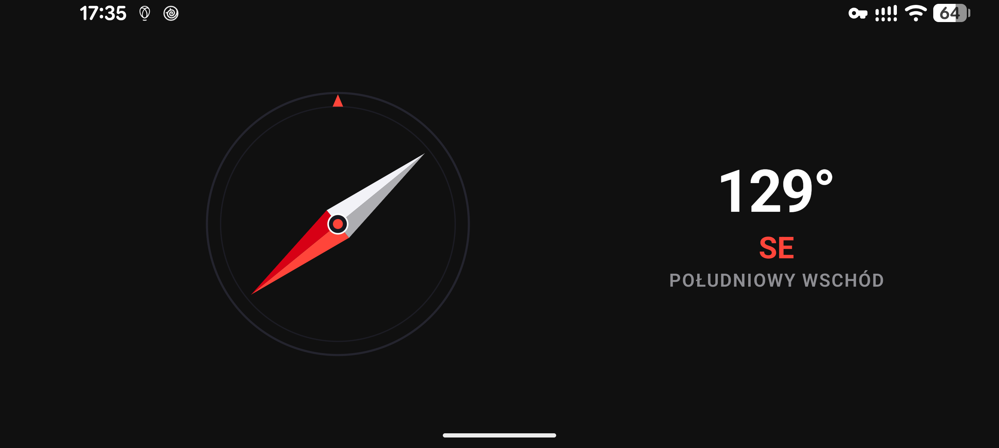

# Kompas 🧭

[](https://github.com/lukasz-sklad/kompas/actions)
[-brightgreen.svg)](https://developer.android.com)
[-blue.svg)](https://developer.android.com)
[](LICENSE)
[-success.svg)](#)
[](#)
[](#)

> **Czysty, precyzyjny i całkowicie offline kompas 3D na system Android.**  
> Zero reklam, zero modułów śledzących, zero zbędnych uprawnień. Działa natychmiast i chroni Twoją prywatność w każdych warunkach.

---

## 🌟 Najważniejsze Cechy

* 🧭 **Prawdziwy Instrument 3D:** Dynamiczna, płynna igła z matem i cieniowaniem, reagująca na fizyczny obrót telefonu (60/120 FPS).
* 📐 **Pełna Obsługa Orientacji (Pion i Poziom):** Niezależny algorytm przemapowania osi sensorów (`SensorManager.remapCoordinateSystem`). W poziomie igła i stopnie kątowe elegancko dzielą przestrzeń bez kolizji.
* 🛡️ **100% Offline & Zero Uprawnień Sieciowych:** Aplikacja **nie posiada** uprawnienia `INTERNET`. Żadne dane nigdy nie opuszczają Twojego urządzenia.
* ⚡ **Ultra Lekka (~700 KB APK):** Kod zoptymalizowany pod kątem braku ciężkich bibliotek i grafik rastrowych. Cała tarcza i igła rysowane wektorowo w Jetpack Compose Canvas.
* 🔋 **Zoptymalizowany pod Ekrany OLED:** Głęboka czerń tła i brak rozbłysków przy uruchamianiu (*No White Flash*).
* 🎯 **Maksymalny Globalny Zasięg:** Zgodność z 99.5% urządzeń z systemem Android na świecie (Android 8.0 Oreo do najnowszego Androida 16).

---

## 📸 Zrzuty Ekranu

| Orientacja Pionowa | Orientacja Pozioma (Landscape) |
| :---: | :---: |
|  |  |

---

## 🛠️ Architektura i Technologie

* **Język:** Kotlin (100%)
* **Interfejs użytkownika:** Jetpack Compose (Material 3)
* **Silnik sensorów:** Android Hardware Sensor API (`TYPE_ROTATION_VECTOR` z płynną interpolacją Slerp i fallbackiem na akcelerometr/magnetometr)
* **Minifikacja:** R8 Full Mode + ProGuard Resource Shrinking
* **CI/CD:** GitHub Actions (automatyczne testy jednostkowe, CodeQL security scan, budowanie AAB/APK)

---

## 🚀 Jak Zbudować Projekt Lokalnie

### Wymagania:
* JDK 17 (np. Temurin / OpenJDK 17)
* Android SDK (compileSdk 36)

```bash
# Klonowanie repozytorium
git clone https://github.com/lukasz-sklad/kompas.git
cd kompas

# Uruchomienie testów jednostkowych
./gradlew test

# Zbudowanie instalatora APK (wersja Debug)
./gradlew assembleDebug

# Zbudowanie zoptymalizowanej paczki produkcyjnej (Release AAB)
./gradlew bundleRelease
```

---

## 🛡️ Bezpieczeństwo i CVE

Repozytorium korzysta z automatycznych narzędzi weryfikacji bezpieczeństwa:
* **GitHub CodeQL:** Skanowanie kodu pod kątem podatności pamięciowych, wycieków i błędów implementacji.
* **Dependabot:** Cotygodniowy monitoring zależności przeciwko globalnej bazie CVE.
* Szczegółowe zasady zgłaszania uwag znajdziesz w pliku [SECURITY.md](SECURITY.md).

---

## 🌐 Informacje i Linki

* **Strona domowa i polityka prywatności:** [https://kompas.lmk.one](https://kompas.lmk.one)
* **Kontakt:** `dev@lmk.one`
* **Licencja:** [MIT License](LICENSE)
